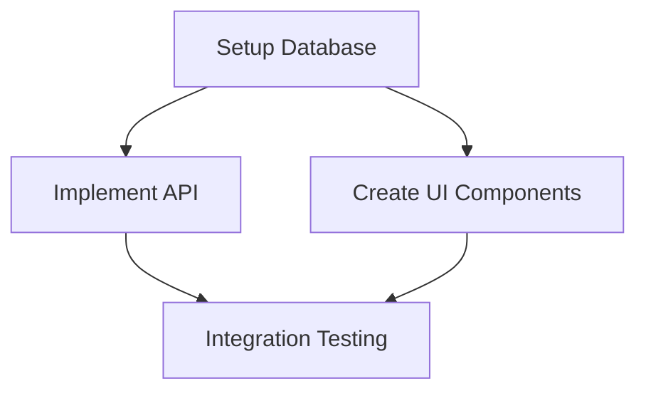

# AI Agent Workflow Management System

A comprehensive framework for managing complex development tasks through specialized AI agents following an iterative Implementation → Testing → Documentation workflow.

## Overview

This system provides:
- **Multi-Agent Workflow**: Specialized agents for implementation, testing, and documentation
- **Real-Time Context Management**: Updates after every significant action for seamless recovery
- **Git Integration**: Automatic commits with structured messages
- **Session Continuity**: Zero-search recovery with comprehensive context files
- **Task Tracking**: Centralized todo management with dependencies and priorities

## Quick Start

### 1. Copy to Your Project
```bash
# Copy the entire ai-agent-workflow directory to your project root
cp -r ai-agent-workflow /path/to/your/project/

# Or clone/download and integrate
git clone <repository-url> ai-agent-workflow
```

### 2. Initialize for Your Project
```bash
cd ai-agent-workflow

# Copy templates for your first task
cp templates/task-template.md tasks/your-first-task.md
cp templates/context-template.md context/your-first-task.md

# Edit the files with your task details
# Update todo.md with your task
```

### 3. Start Working
```bash
# Read the startup guide
cat STARTUP_PROMPT.md

# Check active tasks
cat todo.md

# Begin with your first task
```

## System Architecture

### Directory Structure
```
ai-agent-workflow/
├── context/             # Real-time context files
├── tasks/              # Task definitions
├── templates/          # Reusable templates
├── todo.md             # Master task tracking
├── STARTUP_PROMPT.md   # Session startup and recovery protocol
├── WORKFLOW.md         # Detailed workflow documentation
└── README.md           # This file
```

### Multi-Agent Workflow

#### 1. Implementation Agent
- **Focus**: Code implementation and technical decisions
- **Context File**: `<task-name>-implementation.md`
- **Responsibilities**:
  - Write production-quality code
  - Follow project conventions
  - Document technical decisions
  - Prepare for comprehensive testing

#### 2. Testing Agent
- **Focus**: Comprehensive validation and quality assurance
- **Context File**: `<task-name>-testing.md`
- **Responsibilities**:
  - Run ALL tests (not just new ones)
  - Validate no regressions introduced
  - Test edge cases and integration scenarios
  - Provide detailed feedback for fixes

#### 3. Documentation Agent
- **Focus**: Technical writing and documentation
- **Context File**: `<task-name>-documentation.md`
- **Responsibilities**:
  - Update API documentation
  - Maintain README and guides
  - Ensure documentation accuracy
  - Create user-facing documentation

### Iterative Workflow
```
Task Assignment → Implementation → Testing → Documentation
       ↑              ↓            ↓
       └────── Failed Tests ───────┘
              (with detailed feedback)
```

## Usage Guide

### Creating a New Task

1. **Copy Templates**:
   ```bash
   cp templates/task-template.md tasks/your-task-name.md
   cp templates/context-template.md context/your-task-name.md
   ```

2. **Define the Task**:
   - Edit `tasks/your-task-name.md`
   - Include clear acceptance criteria
   - Define implementation plan
   - Specify testing requirements

3. **Update Master Todo**:
   - Add task to `todo.md`
   - Set priority (P0/P1/P2/P3)
   - Note dependencies

4. **Start Implementation**:
   - Update context file with current status
   - Begin coding with real-time updates

### Session Management

#### Starting a Session
```bash
# Always start here
cat todo.md

# Load active task context
cat context/active-task.md

# Continue from documented next step
```

#### During Implementation
- Update context file after **EVERY** significant action
- Include timestamps with `date` command
- Commit changes immediately with structured messages
- Document decisions, code locations, and test results

#### Session Recovery
- Context files contain ALL necessary information
- No searching required - exact next step is documented
- Maximum 1 step behind due to real-time updates
- Environment setup and current state preserved

### Git Integration

#### Commit Message Format
```bash
# Context updates
git commit -m "context: <task-name> - <action>"

# Implementation work
git commit -m "impl: <task-name> - <implementation-action>"

# Testing work
git commit -m "test: <task-name> - <testing-action>"

# Documentation work
git commit -m "docs: <task-name> - <documentation-action>"
```

#### Best Practices
- Commit after **every** context update
- Include related code files in commits
- Use descriptive, specific commit messages
- Reference commit hashes in context files

## Real-Time Context Management

### Mandatory Update Triggers
1. **After each file edit** - Update Code Locations section
2. **After each test run** - Update Testing section with results
3. **After each decision** - Update Key Decisions with rationale
4. **After each git operation** - Update Implementation Notes
5. **Before any long operation** - Save current state
6. **When approaching context limits** - Ensure complete state capture

### Context File Structure
```markdown
# Context: [Task Name]

## Task Summary
[Brief description and task file reference]

## Current State (Last updated: HH:MM TIMEZONE)
- **Working on**: [Exact current action]
- **Next step**: [Immediate next action]

## Key Decisions (Updated in real-time)
- **HH:MM TIMEZONE**: [Decision]
  - Problem: [What needed solving]
  - Rationale: [Why this choice]

## Code Locations (Updated after each edit)
- `file:line-range`: [Description] (HH:MM TIMEZONE)

## Testing Log (Updated after each test run)
- **HH:MM TIMEZONE**: `command` - RESULT (details)
```

## Agent Specialization

### Implementation Agent Personas
- **API Development**: "REST API specialist focused on clean interfaces"
- **Database Operations**: "Database engineer focused on efficient queries"
- **Parser Implementation**: "Compiler engineer specializing in AST parsing"
- **UI Components**: "Frontend developer specializing in accessible components"

### Testing Agent Personas
- **Performance Testing**: "Performance engineer ensuring no regressions"
- **Integration Testing**: "QA engineer focused on cross-component interactions"
- **Security Testing**: "Security specialist validating input sanitization"
- **API Testing**: "API testing expert ensuring contracts and data validation"

### Documentation Agent Personas
- **API Documentation**: "Technical writer specializing in API documentation"
- **Architecture Documentation**: "System architect documenting design decisions"
- **User Documentation**: "UX writer creating clear, actionable user guides"

## Integration with Development Environments

### Environment Detection
```bash
# Automatic environment detection
if command -v nix >/dev/null 2>&1; then
  echo "NixOS environment detected"
  # Use nix develop for commands
  nix develop -c -- <command>
else
  echo "Standard environment"
  # Run commands directly
  <command>
fi
```

### Testing Framework Integration
- **Adapt test commands** to your project's testing framework
- **Update WORKFLOW.md** with your specific test commands
- **Configure environment** for your development setup
- **Document build processes** in context files

## Advanced Features

### Task Dependencies


### Priority System
- **P0 CRITICAL**: Must complete first, blocking other work
- **P1 HIGH**: Core functionality and features
- **P2 MEDIUM**: Enhancements and optimizations
- **P3 LOW**: Nice-to-have improvements

### Emergency Recovery
When approaching context limits:
1. **Save complete current state**
2. **Commit emergency save**
3. **Document recovery instructions**
4. **New session loads from context file**

## Troubleshooting

### Common Issues

#### Missing Context
```bash
# Check recent context commits
git log --oneline -10 | grep "context:"

# Load most recent context file
cat context/<task-name>.md
```

#### Conflicting Information
- Check timestamps for most recent updates
- Validate against actual codebase state
- Update with current accurate information

#### Environment Issues
- Document environment setup in context files
- Include reproduction steps for issues
- Record solutions for future reference

### Recovery Protocol
1. **Load todo.md** - Check active tasks
2. **Load context file** - Get complete current state
3. **Verify environment** - Check development setup
4. **Continue from documented step** - No investigation needed

## Best Practices

### Context File Quality
- Be specific about decisions and rationale
- Include enough detail for complete reconstruction
- Document failed approaches to avoid repetition
- Maintain professional, technical tone

### Task Definition Quality
- Clear, measurable acceptance criteria
- Realistic implementation timelines
- Proper dependency identification
- Regular status updates

### Git Hygiene
- Commit frequently with context updates
- Use structured commit messages
- Include related files in commits
- Reference commits in context files

## Examples

### Example Task Creation
```bash
# 1. Create task file
cp templates/task-template.md tasks/add-user-authentication.md

# 2. Create context file
cp templates/context-template.md context/add-user-authentication.md

# 3. Edit task definition
# - Objective: Implement user authentication system
# - Acceptance criteria: Login, logout, password reset
# - Implementation plan: Database schema, API endpoints, UI components

# 4. Update todo.md
# - Add to P1 HIGH priority
# - Note dependencies (database setup, UI framework)

# 5. Start implementation
# - Update context with current status
# - Begin coding with real-time updates
```

### Example Context Update
```markdown
## Current State (Last updated: 14:30 CEST)
- **Working on**: Implementing login API endpoint
- **Next step**: Add password hashing middleware
- **Files open**: src/auth/login.rs, tests/auth_test.rs

## Code Locations (Updated after each edit)
- `src/auth/login.rs:25-45`: Added login endpoint handler (14:25 CEST)
- `src/auth/middleware.rs:10-20`: Added password validation (14:28 CEST)

## Testing Log (Updated after each test run)
- **14:30 CEST**: `npm test auth` - PASSED (5 tests)
  - Login endpoint returns correct response
  - Password validation working
  - No regressions in existing auth tests
```

## Contributing

### Adding New Agent Types
1. Define agent persona and specialization
2. Create context file template for the agent type
3. Update WORKFLOW.md with agent-specific guidance
4. Add examples to README.md

### Customizing for Your Project
1. Update test commands in WORKFLOW.md
2. Modify environment detection logic
3. Add project-specific templates
4. Configure build and deployment processes

## License

This AI Agent Workflow Management System is designed to be integrated into any development project. Customize the templates and workflows to match your team's processes and tools.

---

*AI Agent Workflow Management System v1.0*
*For questions or issues, refer to the troubleshooting section or create an issue in your project repository.*