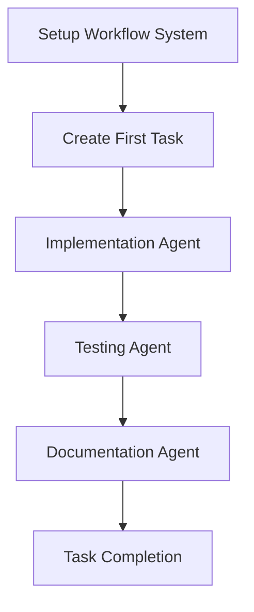

# AI Agent Task Management System

## Overview
This is the AI Agent Workflow Management System - a comprehensive framework for managing complex development tasks through specialized AI agents following an iterative Implementation → Testing → Documentation workflow.

## System Architecture
- **Multi-Agent Workflow**: Implementation → Testing → Documentation cycle
- **Real-Time Context Management**: Updates after every significant action
- **Git Integration**: Automatic commits with structured messages
- **Session Continuity**: Zero-search recovery with context files
- **Task Tracking**: Centralized todo management with dependencies

## Directory Structure
```
ai-agent-workflow/
├── context/             # Real-time context files
├── tasks/              # Task definitions and requirements
├── templates/          # Reusable templates
├── todo.md             # This file - master task tracking
├── STARTUP_PROMPT.md   # Session startup and recovery protocol
├── WORKFLOW.md         # Detailed workflow documentation
└── README.md           # Setup and usage guide
```

## Active Tasks
*Currently in progress*

## P0 CRITICAL Tasks
*Must complete first - Foundation building*

## P1 HIGH Priority Tasks
*Core functionality and features*

## P2 MEDIUM Priority Tasks
*Enhancements and optimizations*

## P3 LOW Priority Tasks
*Nice-to-have improvements*

## Completed Tasks
*Finished work with references*

## Task Dependencies and Critical Path
*Relationships and ordering based on project requirements*

### Critical Path:


## Resource Requirements

### Team Roles
- **Implementation Agents**: Specialized by task type (API, Database, UI, etc.)
- **Testing Agents**: Comprehensive validation (Unit, Integration, Performance)
- **Documentation Agents**: Technical writing and API documentation

## Success Metrics

### Workflow Efficiency
- **Zero Context Loss**: All sessions recoverable in <1 minute
- **Real-Time Updates**: Context updated after every significant action
- **Multi-Agent Handoffs**: Seamless transitions between specialized agents
- **Git Integration**: All changes committed with structured messages

### Task Completion
- **Quality Assurance**: All tasks pass comprehensive testing
- **Documentation**: Complete technical documentation for all features
- **Code Standards**: Consistent with project conventions
- **Integration**: Proper integration with existing codebase

## Notes
- All tasks reference this file for visibility and coordination
- Context files must be updated throughout implementation following WORKFLOW.md protocol
- Multi-agent workflow required: Implementation → Testing → Documentation for each task
- Use specific file paths and line numbers when referencing code changes
- Real timestamps required throughout - no fictional times
- All context updates must be committed to git immediately

---
*Last updated: [Current Timestamp]*
*AI Agent Workflow Management System v1.0*
### Setup Project Workflow
- **Status**: In Progress
- **Priority**: P0 CRITICAL
- **Created**: 2025-08-30 15:20 CEST
- **Context**: [context/setup-project-workflow.md](context/setup-project-workflow.md)
- **Task**: [tasks/setup-project-workflow.md](tasks/setup-project-workflow.md)
- **Description**: Initialize AI Agent Workflow system for unknown project
- **Current Phase**: Implementation Agent setting up workflow

### Setup Project Workflow
- **Status**: In Progress
- **Priority**: P0 CRITICAL
- **Created**: 2025-08-30 15:21 CEST
- **Context**: [context/setup-project-workflow.md](context/setup-project-workflow.md)
- **Task**: [tasks/setup-project-workflow.md](tasks/setup-project-workflow.md)
- **Description**: Initialize AI Agent Workflow system for unknown project
- **Current Phase**: Implementation Agent setting up workflow

### Create Benchmarking Suite
- **Status**: Active
- **Priority**: P0 CRITICAL
- **Created**: 2025-08-30 15:25 CEST
- **Context**: [context/create-benchmarking-suite.md](context/create-benchmarking-suite.md)
- **Task**: [tasks/create-benchmarking-suite.md](tasks/create-benchmarking-suite.md)
- **Description**: Create comprehensive benchmarking suite for QuicCrunch vs gRPC performance comparison
- **Current Phase**: Task created, ready for Implementation Agent
