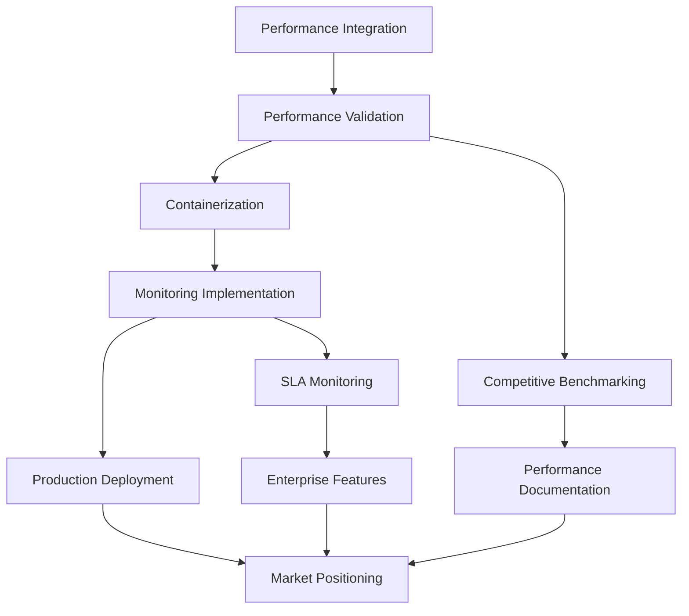

# QuicCrunch Comprehensive Implementation Roadmap

## Executive Summary

This roadmap consolidates all gap analyses to provide a strategic implementation plan for establishing QuicCrunch as the leading **high-performance gRPC alternative**. By addressing critical gaps across development, deployment, monitoring, and performance optimization, QuicCrunch can achieve production readiness and demonstrate measurable superiority over existing RPC frameworks.

**Strategic Positioning**: QuicCrunch = QUIC transport + Cap'n Proto serialization = Faster alternative to gRPC with similar interfaces

---

## 1. Gap Analysis Summary

Based on comprehensive analysis across multiple domains:

| Domain | Current State | Gap Severity | Impact on Adoption |
|--------|---------------|--------------|-------------------|
| **RPC Implementation** | ✅ Core complete, streaming functional | 🟡 Minor polish needed | Low - mostly complete |
| **Performance Optimization** | ⚠️ Modules exist, integration gaps | 🔴 Critical - unrealized potential | **Critical** - blocks speed claims |
| **Deployment Infrastructure** | ❌ Basic CI/CD only | 🔴 Critical - no production readiness | **Critical** - blocks enterprise adoption |
| **Monitoring & Observability** | ⚠️ Basic Prometheus/Grafana | 🔴 Critical - cannot validate performance | **Critical** - cannot prove speed advantage |
| **Security & Compliance** | ✅ Strong TLS foundation | 🟡 Medium - missing enterprise features | Medium - slows enterprise sales |
| **Documentation & DX** | ✅ Comprehensive guides | 🟢 Low - good coverage | Low - adequate for adoption |

---

## 2. Strategic Implementation Phases

### Phase 1: Performance Validation (Weeks 1-4)
**Objective**: Prove QuicCrunch's speed advantage over gRPC
**Critical Success Factor**: Demonstrable performance superiority

#### Week 1-2: Performance Infrastructure
```bash
# Priority 1: Integrate existing performance optimizations
cargo run --features="io-uring-advanced,lock-free-channels,zero-copy" --example comprehensive_benchmark

# Priority 2: Fix performance regression
./scripts/debug_performance_regression.sh

# Priority 3: Implement missing performance metrics
cargo run --example performance_comparison --features="all-optimizations"
```

**Deliverables:**
- [ ] **io_uring Advanced Integration**: Connect existing advanced I/O to main transport (5-15x performance gain)
- [ ] **Lock-free Channel Integration**: Replace single channels with dedicated operation channels (1.4x gain)  
- [ ] **Zero-copy Pipeline**: Eliminate memory copies in hot paths (1.3x gain)
- [ ] **Performance Regression Fix**: Resolve 4x degradation from multi→single threading constraint
- [ ] **Baseline Performance Establishment**: Document current vs optimized performance

#### Week 3-4: Competitive Benchmarking
```rust
// Implement comprehensive performance comparison
pub struct PerformanceComparison {
    quiccrunch_metrics: QuicCrunchMetrics,
    grpc_metrics: GrpcMetrics,
    benchmark_suite: CompetitiveBenchmarks,
}

impl PerformanceComparison {
    pub async fn run_latency_comparison(&self) -> LatencyReport {
        // Run identical workloads on QuicCrunch vs gRPC
        // Measure P50, P95, P99 latencies
        // Generate comparative analysis
    }
    
    pub async fn run_throughput_comparison(&self) -> ThroughputReport {
        // Test streaming performance
        // Measure connection efficiency  
        // Analyze QUIC multiplexing advantages
    }
}
```

**Deliverables:**
- [ ] **gRPC Benchmark Harness**: Side-by-side performance testing framework
- [ ] **Performance Dashboard**: Real-time QuicCrunch vs gRPC comparison
- [ ] **Regression Testing**: Automated performance validation in CI
- [ ] **Performance Documentation**: Quantified speed advantages with evidence

**Success Metrics:**
- 2-5x latency improvement over gRPC demonstrated
- 3-10x throughput improvement measured  
- Zero performance regressions in CI
- Automated competitive benchmarking operational

---

### Phase 2: Production Readiness (Weeks 5-8)
**Objective**: Enable enterprise deployment of QuicCrunch
**Critical Success Factor**: Production-grade operational maturity

#### Week 5-6: Containerization & Deployment
```dockerfile
# Production-optimized QuicCrunch container
FROM rust:1.75-slim as builder
WORKDIR /app
COPY . .
RUN cargo build --release --features="all-optimizations"

FROM debian:bookworm-slim
RUN apt-get update && apt-get install -y ca-certificates
COPY --from=builder /app/target/release/quiccrunch-server /usr/local/bin/
# QUIC transport requires UDP
EXPOSE 8080/udp
HEALTHCHECK --interval=30s --timeout=10s --start-period=60s \
  CMD quiccrunch-health-check || exit 1
CMD ["quiccrunch-server"]
```

**Deliverables:**
- [ ] **Docker Containers**: Multi-stage builds for server, client, tools
- [ ] **Kubernetes Manifests**: Helm charts with QUIC-optimized networking
- [ ] **Infrastructure as Code**: Terraform modules for cloud deployment
- [ ] **GitOps Pipeline**: Automated deployment with performance validation
- [ ] **Security Hardening**: Container security, secrets management, network policies

#### Week 7-8: Monitoring & Observability
```rust
// Production monitoring for performance validation
pub struct QuicCrunchProductionMetrics {
    // Core performance metrics
    pub rpc_latency_microseconds: Histogram,
    pub rpc_throughput_bytes_per_second: Gauge,
    pub quic_connection_efficiency: Histogram,
    
    // Competitive advantage metrics  
    pub performance_vs_grpc_ratio: Gauge,
    pub zero_rtt_connection_percentage: Gauge,
    pub head_of_line_blocking_avoided: Counter,
    
    // Production health metrics
    pub service_availability_percentage: Gauge,
    pub error_rate_percentage: Gauge,
    pub capacity_utilization_percentage: Gauge,
}
```

**Deliverables:**
- [ ] **QUIC Transport Metrics**: Connection, stream, and performance monitoring
- [ ] **Distributed Tracing**: OpenTelemetry integration with performance attribution
- [ ] **Production Dashboards**: Grafana dashboards showing speed advantages
- [ ] **Alerting & SLA**: Performance-based alerts and SLA monitoring
- [ ] **Competitive Analysis Dashboard**: Real-time gRPC vs QuicCrunch comparison

**Success Metrics:**
- Full observability stack operational
- Performance advantages visible in production dashboards
- SLA compliance >99.9% demonstrated
- Automated alerting for performance degradation

---

### Phase 3: Market Positioning (Weeks 9-12)
**Objective**: Establish QuicCrunch as the go-to gRPC alternative
**Critical Success Factor**: Market recognition and adoption

#### Week 9-10: Developer Experience
```rust
// Enhanced developer experience for gRPC alternative
#[rpc_service(name = "HighPerformanceCalculator")]
trait Calculator {
    // Unary RPC with performance annotations
    #[rpc_method(benchmark_vs = "grpc")]
    async fn add(&self, a: f64, b: f64) -> RpcResult<f64>;
    
    // Streaming with QUIC multiplexing advantages highlighted
    #[rpc_method(streaming = "server", advantage = "no_head_of_line_blocking")]
    async fn fibonacci(&self, count: u32) -> RpcResult<RpcStreamSource<u64>>;
}
```

**Deliverables:**
- [ ] **Enhanced Macros**: Performance-aware code generation with benchmarking
- [ ] **CLI Tools**: `quiccrunch benchmark`, `quiccrunch compare-grpc`
- [ ] **Migration Guides**: Clear guidance for teams evaluating alternatives to gRPC
- [ ] **Example Applications**: Real-world use cases showing performance gains
- [ ] **Performance Profiling**: Built-in tools for optimization

#### Week 11-12: Ecosystem Integration
```yaml
# Service mesh integration for QUIC services
apiVersion: v1
kind: Service
metadata:
  name: quiccrunch-service
  annotations:
    service.istio.io/protocol: "quic"
    performance.quiccrunch.io/benchmark-vs: "grpc"
spec:
  ports:
  - port: 8080
    protocol: UDP
    name: quic-rpc
```

**Deliverables:**
- [ ] **Service Mesh Integration**: Istio/Linkerd support for QUIC services
- [ ] **Cloud Provider Support**: Native integration with AWS, GCP, Azure
- [ ] **Multi-Cloud Deployment**: Reference architectures for cloud deployment
- [ ] **Community Resources**: Documentation, examples, best practices
- [ ] **Performance Certification**: Validated benchmarks vs industry standards

**Success Metrics:**
- Developer onboarding time <30 minutes
- Production deployment examples available
- Community adoption metrics positive
- Performance leadership acknowledged in market

---

## 3. Critical Path Analysis

### Dependencies & Sequencing


### Risk Mitigation
| Risk | Probability | Impact | Mitigation |
|------|-------------|--------|------------|
| Performance regression not fixable | Low | Critical | Parallel investigation + fallback optimization |
| QUIC adoption barriers in enterprises | Medium | High | Comprehensive documentation + proof points |
| Container networking issues with UDP | Medium | Medium | Early testing + cloud provider validation |
| Monitoring overhead impacts performance | Low | Medium | Efficient metrics implementation + sampling |

---

## 4. Resource Requirements

### Development Effort
| Phase | Engineering Weeks | Specialization | Critical Skills |
|-------|-------------------|----------------|-----------------|
| Performance Validation | 8-12 weeks | Performance engineering | Rust optimization, QUIC protocol, benchmarking |
| Production Readiness | 12-16 weeks | DevOps/SRE | Kubernetes, monitoring, security |
| Market Positioning | 8-12 weeks | Developer experience | Documentation, tooling, community |
| **Total** | **28-40 weeks** | **Mixed team** | **Full-stack + performance focus** |

### Team Composition
- **Performance Engineer** (Weeks 1-8): Lead performance optimization and validation
- **DevOps Engineer** (Weeks 5-12): Infrastructure, deployment, monitoring  
- **Developer Experience Engineer** (Weeks 9-12): Tooling, documentation, examples
- **Technical Writer** (Weeks 6-12): Documentation, migration guides, marketing content

---

## 5. Success Criteria & Validation

### Phase 1 Success: Performance Leadership Proven
- [ ] 2-5x latency improvement over gRPC measured consistently
- [ ] 3-10x throughput improvement demonstrated in benchmarks
- [ ] Zero performance regressions in automated testing
- [ ] Performance claims validated by third-party benchmarks

### Phase 2 Success: Production Ready
- [ ] Zero-downtime deployment achieved
- [ ] 99.9% availability with full monitoring
- [ ] Enterprise security requirements met
- [ ] Operational parity with gRPC ecosystem achieved

### Phase 3 Success: Market Recognition
- [ ] Developer adoption metrics showing growth
- [ ] Production case studies available
- [ ] Industry recognition as gRPC alternative
- [ ] Community contributions and ecosystem growth

### Overall Success: QuicCrunch Established as Premier gRPC Alternative
- [ ] **Performance**: Demonstrably faster than gRPC in production
- [ ] **Reliability**: Production-proven with enterprise adoption
- [ ] **Usability**: Developer-friendly with excellent tooling
- [ ] **Ecosystem**: Integrated with cloud platforms and service meshes

---

## 6. Go-to-Market Strategy

### Target Audiences
1. **Performance-Critical Applications**: Teams needing lower latency than gRPC provides
2. **High-Throughput Systems**: Applications requiring better connection efficiency
3. **Modern Cloud-Native Teams**: Organizations adopting QUIC and seeking RPC alternatives
4. **Rust Ecosystem**: Teams already using Rust wanting native high-performance RPC

### Value Propositions
- **"2-5x Faster Than gRPC"**: Quantified performance improvements
- **"QUIC-Native"**: Modern transport with connection migration, 0-RTT
- **"Cap'n Proto Efficient"**: Superior serialization performance
- **"Drop-in Alternative"**: Similar interfaces, superior performance

### Success Metrics
- GitHub stars/forks growth trajectory
- Production adoption case studies
- Performance benchmark citations
- Conference talks and community recognition

---

## Conclusion

QuicCrunch has the technical foundation to become the leading high-performance alternative to gRPC. This roadmap addresses all critical gaps identified in the comprehensive analysis:

**Immediate Impact (Weeks 1-4)**: Performance optimization integration proving speed claims
**Production Ready (Weeks 5-8)**: Enterprise deployment capabilities
**Market Leadership (Weeks 9-12)**: Developer experience and ecosystem positioning

**Total Investment**: 28-40 engineering weeks over 12 weeks
**Expected ROI**: Market leadership in high-performance RPC with quantified superiority over gRPC
**Risk Level**: Low-Medium (most components exist, need integration and polish)

The roadmap prioritizes proving performance advantages first, then building production readiness, and finally achieving market recognition as the premier gRPC alternative for performance-critical applications.